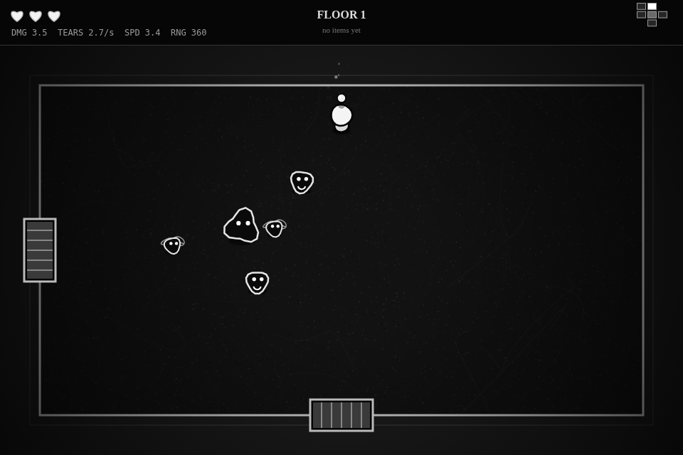

# Ink Depths

A twin-stick dungeon roguelike drawn in black and white ink, inspired by *The Binding of Isaac*.
Pure HTML5 Canvas and vanilla JavaScript: no build step, no dependencies.

**Play:** https://shirenos.github.io/ink-depths/

## Controls

| Key | Action |
| --- | --- |
| WASD | Move |
| Arrow keys | Shoot (or hold the left mouse button to aim with the mouse) |
| Esc / P | Pause |
| R | Restart (from pause or the death screen) |
| M | Mute sound |
|## Story

"This is the story of Ada, who stopped drawing the day her little brother did not come home." One night the
ink in an old pen pools on the floor like an open door, and the child follows a distant laugh down. Every floor
is a memory: the nursery, the garden, the white hospital corridor, nine days of rain, an empty room, the last
goodbye, and at the bottom, an unfinished page. Cutscenes play at the start, after every boss, before the final
fight and at the ending. Item descriptions, enemy names and scribbled notes on the floor hold clues. Not every
storyteller tells it the way it happened.

## Bosses

Seven floors, each with its own boss (every boss gets angrier below half health and gains an extra attack; the final boss telegraphs its heaviest attacks):

1. **The Cradle Moth**: flutters in a figure eight, fires spreads, calls flies, then spins a dust spiral
2. **The Thorn Gardener**: stalks you, throws thorn rings with a single gap and lines of vines, plants turrets
3. **The Night Nurse**: fades out, reappears far away and fires aimed bursts
4. **The Rain Choir**: sways along the top wall while rain falls across the room, later from the sides too
5. **The Hollow Toybox**: charges and bounces off walls, spilling shots on every hit, releases splitters
6. **The Mourning Bell**: rotating spiral arms with short rests and slow tolling rings
7. **The Unwritten** (final): three phases: a mirror that copies you from across the room, echoes of every earlier memory, and a dense unravelling spiral

Beating the final boss plays the ending and a credits screen with run stats; you can restart or keep descending into endless floors.

## Items

Thirty items: stat ups, piercing, homing, multishot, spectral, backward, slowing, poison, critical, splitting,
bouncing and wavy tears, orbiting moths, shadow familiars, knockback, life-steal, a shield that blocks the
first hit per room, exploding enemies, a damaging aura, healing on room clear and more. Some pairs form
synergies (for example Third Eye + Iron Needle, Forked Tongue + Twin Shadow, Salt Tear + Nightshade Ink).
Every pickup shows its name and effect.

## Enemies

Twelve enemy types, each one an echo of the story; the game names each one the first time you meet it.
Deeper floors bring new types, more enemies per room, crowded rooms and elite variants (white outline,
more health). Newer types include the Drip Wraith (drifts through rocks), the Raincloud (leaves slowing
puddles), the Night-light Spider (telegraphed leaps), the Night Lamp (aims a laser line, then fires),
Hush (shields nearby allies and calls more) and the Rubber Ball (bounces off walls and rocks).

## Features

- Procedurally generated floors on a grid: doors lock until a room is cleared, minimap in the corner
- Six enemy types: flies, chasers, shooters, splitters, dashers, radial turrets
- Treasure room on every floor; hearts drop from cleared rooms, always on a free spot
- Death and ending screens with run stats
- Ink aesthetic: paper grain, wobbling ink outlines, splats, particles and screen shake
- Procedural sound effects made with the Web Audio API

shake
- Procedural sound effects made with the Web Audio API

## Run locally

Open `index.html` in a browser, or serve the folder: `python3 -m http.server`.

## License

MIT
